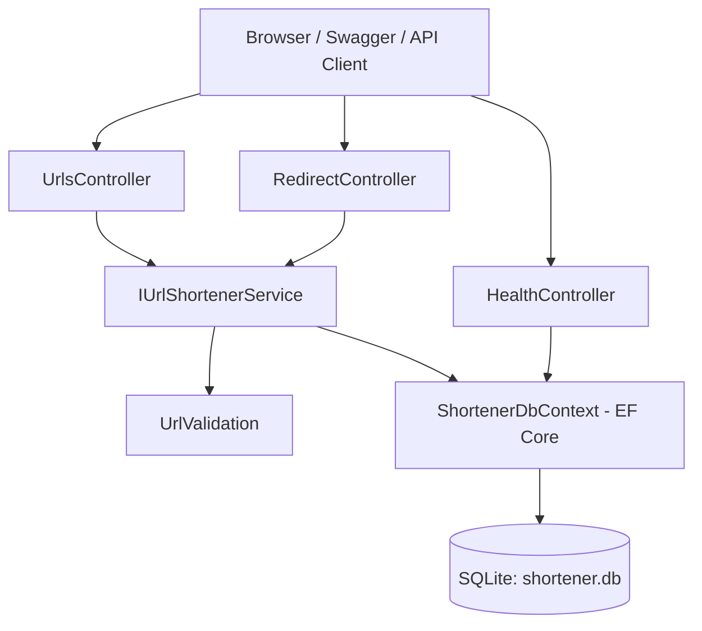

# AI-Assisted URL Shortener — ASP.NET Core Web API

A lightweight, reviewable URL shortening REST API built with **ASP.NET Core 8**, **C#**, **Entity Framework Core**, and **SQLite**. The prototype supports short-link creation, custom aliases, redirects, click analytics, optional expiry, disabling links, and a database health endpoint.

This repository is also an **AI-assisted engineering assessment submission**. It documents requirement interpretation, greenfield/brownfield/ambiguous scenarios, implementation decisions, test strategy, risks, and the distinction between AI suggestions and engineer-approved work.

> **Project status:** Local prototype. API flows have been manually tested by the developer. Automated tests and GitHub CI should be verified on the submitted commit; do not infer successful CI from the presence of the workflow file.

## Features

- Create an 8-character randomly generated short code for an absolute HTTP(S) URL.
- Provide a custom alias (3–32 characters; letters, numbers, `_`, `-`; reserved route names prohibited).
- Resolve a code with an HTTP **302** redirect and record the visit.
- Return aggregate click count and link timestamps.
- Optionally set expiration from **1–365 days** at creation.
- Disable links without deleting their analytics.
- Reject invalid/local-network destination formats and duplicate aliases.
- Check database connectivity with `/health`.
- Run integration tests using xUnit and `WebApplicationFactory`.

## Technology stack

| Layer | Technology |
| --- | --- |
| API | ASP.NET Core Web API, .NET 8, C# |
| API docs | Swagger / Swashbuckle |
| Business logic | `IUrlShortenerService` / `UrlShortenerService` |
| Persistence | Entity Framework Core 8 + SQLite |
| Tests | xUnit + ASP.NET Core `WebApplicationFactory` |
| Automation | GitHub Actions (restore, build, test) |
| Development | Visual Studio, VS Code, or .NET CLI |

## Architecture



- **Controllers** handle HTTP requests/responses.
- **Service** handles short-code creation, alias checks, expiration, deactivation, and click tracking.
- **Validation** rejects unsupported URL forms and restricted local IP destinations.
- **DbContext** stores `ShortLink` entities with a unique code index.
- **Exception middleware** maps expected application errors to HTTP responses.

See [Architecture and decisions](docs/ARCHITECTURE.md).

## Project structure

```text
.
├── .github/workflows/ci.yml
├── docs/
│   ├── ARCHITECTURE.md
│   ├── ENGINEERING_SCENARIOS.md
│   ├── AI_ASSISTANCE_LOG.md
│   └── FINAL_SUMMARY.md
├── src/UrlShortener.Api/
│   ├── Contracts/
│   ├── Controllers/
│   │   ├── HealthController.cs
│   │   ├── RedirectController.cs
│   │   └── UrlsController.cs
│   ├── Data/ShortenerDbContext.cs
│   ├── Domain/ShortLink.cs
│   ├── Middleware/ApiExceptionMiddleware.cs
│   ├── Services/
│   │   ├── IUrlShortenerService.cs
│   │   ├── UrlShortenerService.cs
│   │   └── UrlValidation.cs
│   ├── Program.cs
│   └── appsettings.json
├── tests/UrlShortener.Tests/UrlApiTests.cs
└── UrlShortener.sln
```

## Prerequisites

- **.NET 8 SDK** (not merely the runtime): https://dotnet.microsoft.com/download/dotnet/8.0
- Git to clone the repository (optional when using GitHub's ZIP download)
- Visual Studio with ASP.NET/web development tools, VS Code, or terminal
- Internet connection on first restore to download NuGet packages
- Optional: DB Browser for SQLite — https://sqlitebrowser.org/

Confirm the SDK:

```bash
dotnet --info
```

No SQL Server installation is required.

## Run locally

From the repository root:

```bash
git clone https://github.com/YOUR_USERNAME/ai-assisted-url-shortener-dotnet.git
cd ai-assisted-url-shortener-dotnet
dotnet restore UrlShortener.sln
dotnet build UrlShortener.sln
dotnet run --project src/UrlShortener.Api --launch-profile UrlShortener.Api
```

Swagger: **http://localhost:5080/swagger**  
Health endpoint: **http://localhost:5080/health**

The supplied launch profile uses HTTP port `5080`; if you use a different launch configuration, use the address printed in the terminal. A first startup automatically creates the SQLite database and tables using `EnsureCreatedAsync()`.

### Run with Visual Studio

1. Open `UrlShortener.sln`.
2. Select `UrlShortener.Api` as the startup project.
3. Restore packages, then run the `UrlShortener.Api` launch profile.
4. Open the Swagger page and try the create endpoint.

## API endpoints

| Method | Route | Purpose | Typical success |
| --- | --- | --- | --- |
| `POST` | `/api/v1/urls` | Create a short URL | `201 Created` |
| `GET` | `/{code}` | Redirect and count a visit | `302 Found` |
| `GET` | `/api/v1/urls/{code}/stats` | Read click metrics and status | `200 OK` |
| `DELETE` | `/api/v1/urls/{code}` | Disable a short URL | `204 No Content` |
| `GET` | `/health` | Verify DB connectivity | `200 OK` |

### Create a short URL

`POST http://localhost:5080/api/v1/urls`

```json
{
  "originalUrl": "https://example.com/page",
  "customAlias": "demo123",
  "expiresInDays": 30
}
```

`customAlias` and `expiresInDays` are optional. Omit `customAlias` to generate an 8-character code; omit `expiresInDays` for a link without a configured expiration date.

Example `201 Created` response (dates are illustrative):

```json
{
  "code": "demo123",
  "shortUrl": "http://localhost:5080/demo123",
  "originalUrl": "https://example.com/page",
  "createdAtUtc": "2026-10-13T07:00:00Z",
  "expiresAtUtc": "2026-11-12T07:00:00Z"
}
```

### Follow a short URL

```bash
curl -i http://localhost:5080/demo123
```

Expected: `302 Found` with a `Location: https://example.com/page` header. Browsers may follow the redirect automatically.

### Retrieve analytics

```bash
curl http://localhost:5080/api/v1/urls/demo123/stats
```

Example:

```json
{
  "code": "demo123",
  "clickCount": 1,
  "createdAtUtc": "2026-10-13T07:00:00Z",
  "expiresAtUtc": "2026-11-12T07:00:00Z",
  "lastAccessedAtUtc": "2026-10-13T07:02:00Z",
  "isActive": true
}
```

### Disable a URL

```bash
curl -i -X DELETE http://localhost:5080/api/v1/urls/demo123
```

Returns `204 No Content`. Redirecting with the disabled code subsequently returns `410 Gone`; the statistics record remains in the database.

### Error behavior

| Condition | Expected status |
| --- | --- |
| Invalid URL / invalid custom alias / expiry outside 1–365 | `400 Bad Request` |
| Missing short code | `404 Not Found` |
| Duplicate custom alias | `409 Conflict` |
| Disabled or expired short URL | `410 Gone` |
| Could not generate unique code after bounded retries | `503 Service Unavailable` |
| Database health check cannot connect | `503 Service Unavailable` |

## Database and local inspection

The app uses **SQLite**; by default its file is:

`src/UrlShortener.Api/shortener.db`

The file is created at startup. Open it using DB Browser for SQLite and select **Browse Data → ShortLinks**, or use the **Execute SQL** tab:

```sql
SELECT Id, Code, OriginalUrl, ClickCount,
       IsActive, CreatedAtUtc, ExpiresAtUtc, LastAccessedAtUtc
FROM ShortLinks
ORDER BY Id DESC;
```

`ShortLinks` tracks code, destination, creation/expiry timestamps, active flag, total click count, and last-access timestamp. `Code` has a unique database index.

The relative/absolute database path can be overridden with `ConnectionStrings:Shortener` (for example, through `ConnectionStrings__Shortener` environment variable). If the database viewer shows outdated data, verify the configured path and refresh the viewer.

**Do not commit** `shortener.db`, its SQLite journal files, connection secrets, `.env`, `bin`, or `obj`. These are excluded by `.gitignore`.

## Automated tests

From the root:

```bash
dotnet restore UrlShortener.sln
dotnet build UrlShortener.sln --configuration Release
dotnet test UrlShortener.sln --configuration Release --no-build --verbosity normal
```

The xUnit integration tests use `WebApplicationFactory<Program>` and a separate temporary SQLite file per test fixture. They do not modify the developer's local database.

### Existing automated coverage

| Test | Behavior verified |
| --- | --- |
| Create → redirect → analytics → disable | 201 creation, 302 redirect, visit count, 204 disable, 410 on disabled redirect |
| Duplicate custom alias | 409 conflict |
| Disallowed URL inputs | 400 for FTP, localhost, loopback IP, file scheme |
| Missing code | 404 |
| Invalid expiry | 400 for 366 days |
| Health endpoint | 200 with DB accessible |

### Recommended additional cases before production use

- Auto-generated alias length and collision retry under injected failures
- Expired link behavior using a controllable clock
- Concurrent redirect increments under load
- Reserved/invalid custom aliases and maximum URL length
- Idempotent disabling and DB outage handling
- Actual response headers and browser-cache behavior
- Security scenarios involving DNS resolution, URL abuse, and rate limiting

**Verification record:** Do not claim all automated tests pass until you have run `dotnet test` on the committed source and confirmed your GitHub Actions result. Include the test command/output or an Actions link after verifying.

## GitHub Actions CI

The workflow at `.github/workflows/ci.yml` runs on pushes and pull requests, installing the .NET 8 SDK, restoring packages, building Release configuration, then executing xUnit tests.

After pushing, check the repository **Actions** tab. A green run is evidence the code builds and tests pass in that runner. A local manual API check and automated CI run demonstrate different aspects of validation.

## AI-assisted engineering process

The engineering approach is **human-led, AI-assisted**, not autonomous orchestration.

1. **Understand requirements:** distinguish explicit deliverables from assumptions (such as code length, alias rules, HTTP statuses, and SQLite choice).
2. **Decompose tasks:** data model and API contract → core functionality → analytics and link lifecycle → tests → documentation and review.
3. **Use AI within scoped tasks:** architecture suggestions, implementation proposals, test scaffolding, refactoring and review feedback.
4. **Review every output:** check generated code, edit or reject recommendations, run it, and evaluate security/reliability trade-offs.
5. **Capture evidence:** record actual prompts, affected files, accepted/edited/rejected decisions, test commands/results, and human approvals.

The supplied [`docs/AI_ASSISTANCE_LOG.md`](docs/AI_ASSISTANCE_LOG.md) contains a starter traceability log. **Update its pending entries with your actual review/test results before submission; do not describe unperformed checks or approvals as completed.**

### Required engineering scenarios

- **Greenfield:** initial API, entity, database, URL generation and redirect.
- **Brownfield:** extending an existing codebase with link disabling and analytics without regressing redirects.
- **Ambiguous:** translating undefined “reliability features” into explicit assumptions, validation, bounded retry, and error behavior.

See [`docs/ENGINEERING_SCENARIOS.md`](docs/ENGINEERING_SCENARIOS.md) for decomposition, implementation, and validation details.

## Reliability and security decisions

- Uses HTTP **302**, not permanent `301`, to allow redirect traffic to reach the service for counting (cache policy should still be tested).
- Click count increments through EF Core's conditional database-side `ExecuteUpdateAsync` to reduce lost updates.
- Unique constraint plus bounded retries reduces random-code collision risk.
- Expired/disabled links fail without losing historical analytics.
- Basic URL validation permits HTTP(S) and blocks known local and reserved literal addresses.
- Database health endpoint checks connectivity.

**Limitations:** This is a prototype without authentication/ownership, rate limits, anti-phishing systems, full hostname/DNS rebinding protection, production-grade monitoring, or schema migrations. It currently uses `EnsureCreatedAsync()` rather than managed migrations. Do not publish it as an open multi-user service without these controls.

## Engineering deliverables

- [Architecture overview](docs/ARCHITECTURE.md)
- [Greenfield, brownfield, ambiguous scenarios](docs/ENGINEERING_SCENARIOS.md)
- [AI usage and review traceability](docs/AI_ASSISTANCE_LOG.md)
- [Engineering summary, trade-offs and next steps](docs/FINAL_SUMMARY.md)

## Submission checklist

- [ ] Clone the repository into a fresh directory and follow the instructions successfully.
- [ ] Run the API and test create, redirect, stats, disable, invalid input, and health.
- [ ] Run `dotnet test UrlShortener.sln` and verify actual results.
- [ ] Push and confirm GitHub Actions succeeds.
- [ ] Update AI-assistance log with actual prompts, review decisions, and signed-off checks.
- [ ] Verify no personal data, internal assessment PDF, credentials, or database files are committed.
- [ ] Confirm links in README work and repository is accessible to reviewers.

## License and use

This repository is a technical assessment demonstration. No open-source license is granted unless a license file is added separately. Ensure any assessment materials are handled in accordance with the sender's sharing restrictions.
