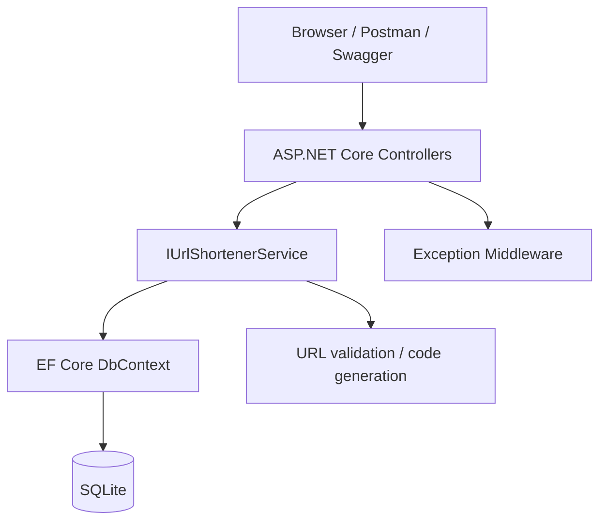

# Architecture and design decisions

## Components and request flow

- `UrlsController`: creation, analytics and disable HTTP interface.
- `RedirectController`: resolves code and returns 302.
- `HealthController`: checks database connectivity.
- `UrlShortenerService`: validation, lifecycle, collision handling and atomic visit counting.
- `ShortenerDbContext`: persistence abstraction; database unique index enforces code uniqueness.
- `ApiExceptionMiddleware`: centralizes errors and avoids leaking internal exception messages.

## Schema
`ShortLinks(Id BIGINT PK, Code VARCHAR(32) UNIQUE, OriginalUrl VARCHAR(2048), CreatedAtUtc DATETIME, ExpiresAtUtc DATETIME NULL, IsActive BOOLEAN, ClickCount BIGINT, LastAccessedAtUtc DATETIME NULL)`.

## Design rationale
- Random Base62 codes are difficult to guess compared with sequential IDs; database unique index covers race conditions. Retries are bounded.
- Redirect uses 302 rather than 301 so browsers don't permanently cache a redirect and bypass tracking.
- Click count uses `ExecuteUpdateAsync` with a database-side increment rather than read/modify/write (reduces lost updates).
- Disabled/expired codes return 410, unknown codes return 404; stopped links remain available for statistics.
- Controller/service/EF separation supports review and automated tests. SQLite reduces evaluator setup overhead.

## Trust boundaries and security
Only absolute HTTP(S) URLs are accepted; common local/reserved IP literals and local hostnames are rejected. This is **not complete anti-phishing or DNS rebinding protection**. A public URL shortener needs abuse controls, ownership authentication, audit logging, traffic quotas and a stricter destination policy. There is no remote URL fetch in the service.

## Production scaling direction
Replace SQLite with SQL Server/PostgreSQL; use migrations, monitoring and rate limits. For larger volumes, consider batching click events to a queue and aggregated analytics rather than synchronously writing per redirect. Idempotent HTTP disable and unique DB constraints remain useful.
